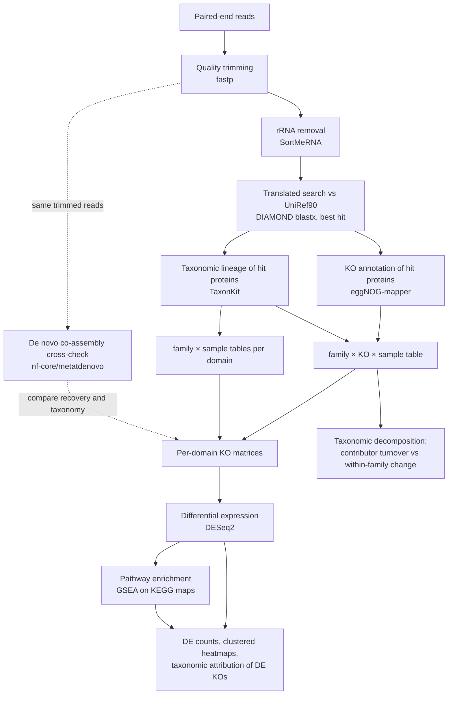

# Soil metatranscriptomics workflow

A read-based workflow for soil metatranscriptomes: from raw Illumina paired-end reads to per-domain KEGG Orthology (KO) count tables with family-level taxonomy, followed by differential expression, pathway enrichment and a taxonomic decomposition of functional transcript changes. An independent de novo co-assembly with **nf-core/metatdenovo** is included as a cross-check of the read-based annotation.

The statistical steps are written for a two-factor design (treatment × time, with replicate samples) and analyse Bacteria and Fungi as separate datasets.

## Workflow



## Repository layout

| Folder | Analysis | Runs on |
|---|---|---|
| [`01_read_processing/`](01_read_processing/) | Trimming, rRNA removal, DIAMOND search against UniRef90, KO annotation, taxonomic lineages, count tables | HPC (SLURM) |
| [`02_count_matrices/`](02_count_matrices/) | Per-domain KO × sample matrices with abundance/prevalence filtering; KO annotation rates | local |
| [`03_differential_expression/`](03_differential_expression/) | DESeq2 `~ treatment * timepoint` per domain with explicit contrast vectors, and a check that each vector equals the intended difference of group means | local (R) |
| [`04_pathway_enrichment/`](04_pathway_enrichment/) | GSEA on the DESeq2 Wald statistic with official KEGG KO-to-map sets; pathway over-representation in clusters of DE KOs | local |
| [`05_expression_visualization/`](05_expression_visualization/) | DE counts per contrast, clustered heatmaps of DE KOs, taxonomic attribution of DE KOs, NES heatmap | local (Python → R) |
| [`06_taxonomic_decomposition/`](06_taxonomic_decomposition/) | Decomposition of community-level functional change into contributor turnover and within-family change, robustness checks, gene-defined functional units | local (Python → R) |
| [`07_denovo_assembly_crosscheck/`](07_denovo_assembly_crosscheck/) | Independent co-assembly of the same reads with nf-core/metatdenovo to double-check the read-based results | HPC (Nextflow) |
| [`environment/`](environment/) | Conda environment for the HPC steps, Python requirements, R session information | |

## Analyses and their scripts

| Analysis | Scripts, in run order |
|---|---|
| Read QC, trimming, rRNA removal | `01/run_01_qc_trim_multiqc.slurm` → `01/run_02_sortmerna.slurm` |
| Functional and taxonomic annotation of reads | `01/run_03_download_index_uniref90.sh` → `run_05_diamond_uniref90.sh` → `run_08_extract_uniref90_hits.sh` → `run_09_emapper_uniref90_hits.sh` → `run_10_extract_uniref90_taxids.sh` → `run_11_taxonkit_lineage.sh` |
| Count tables | `01/12a_parse_taxonomy_counts.py` (family × sample per domain), `01/run_13_parse_ko_counts.sh`, `01/run_13b_parse_ko_taxonomy_full.sh` (family × KO × sample) |
| Annotation robustness to identity threshold (optional) | `01/robustness_identity_threshold/run_13c_parse_ko_taxonomy_pident.sh` |
| Per-domain KO matrices and annotation rates | `02/build_ko_domain_matrices.py`, `02/ko_annotation_rate.py` |
| KO differential expression | `03/deseq2_ko_by_domain.R`, `03/check_contrast_vectors.R` |
| Pathway enrichment (GSEA) | `04/gsea_kegg_pathways.py` (engine in `04/common.py`) |
| DE counts and clustered heatmaps of DE KOs | `05/prepare_de_summary.py` → `05/prepare_de_heatmap_clusters.py` → `05/plot_de_counts_and_heatmaps.R` |
| Pathway enrichment of heatmap clusters | `04/de_cluster_pathway_enrichment.py` (after `prepare_de_heatmap_clusters.py`) |
| Taxonomic attribution of DE KOs and NES heatmap | `05/prepare_gsea_nes_heatmap.py` → `05/plot_taxonomic_attribution_and_gsea.R` |
| Taxonomic decomposition and robustness | `06/build_family_ko_long_table.py` → `06/decomposition_contrasts.py` → `06/decomposition_summary.py`, `06/masking_by_category.py` |
| Gene-defined functional units (cellular-machinery signature) | `06/machinery_signature.py` → `06/plot_signature_sensitivity.py`; summary tables `06/decomposition_tables.py` |
| Decomposition / masking plot | `06/prepare_decomposition_plot.py` → `06/plot_decomposition_masking.R`; independent re-computation `06/verify_decomposition_plot.py` |
| De novo co-assembly cross-check | `07/db_preparation/*` → `07/03_make_samplesheet.sh` → `07/00_prepare_offline.sh` → `07/04_metatdenovo.slurm` |

## Running

### HPC steps

The SLURM scripts read two environment variables and one sample table:

```bash
export PROJ=/path/to/project          # holds data/, db/, results/, logs/ and sample_metadata.tsv
export SCRATCH_DIR=/path/to/scratch   # holds dbs/ (SortMeRNA reference, eggNOG data, NCBI taxdump)
mkdir -p "$PROJ/logs" && cd "$PROJ"
sbatch 01_read_processing/run_01_qc_trim_multiqc.slurm
```

`sample_metadata.tsv` is tab-separated with the columns `sample_id`, `file_prefix` (read-file prefix), `treatment`, `timepoint`, `replicate` and `group`; array job `N` processes row `N`. Set `#SBATCH --array=1-<number of samples>`, the partition names and `--mail-user` for your cluster. `run_01` additionally reads `samples.tsv` (`sample`, `R1`, `R2`, tab-separated). The conda environment is [`environment/env_metatx.yml`](environment/env_metatx.yml).

### Local steps

```bash
pip install -r environment/requirements.txt
export MTX_ROOT=/path/to/analysis      # see layout below
export MTX_OUT=$MTX_ROOT/results
python3 02_count_matrices/build_ko_domain_matrices.py
Rscript 03_differential_expression/deseq2_ko_by_domain.R
Rscript 03_differential_expression/check_contrast_vectors.R
PYTHONPATH=04_pathway_enrichment python3 04_pathway_enrichment/gsea_kegg_pathways.py 5000
```

`gsea_kegg_pathways.py`, `de_cluster_pathway_enrichment.py` and `06/build_family_ko_long_table.py` import `04_pathway_enrichment/common.py`, hence the `PYTHONPATH`. Scripts that take positional arguments document them in their header (`Run: …`). The R plotting scripts source `_style.R` from their own folder and read their data from `FIG_DATA`.

```text
$MTX_ROOT/
├── inputs/
│   ├── sample_metadata.tsv
│   ├── counts_family_{bacteria,fungi,archaea}.tsv    ← 01/12a
│   ├── counts_ko_taxonomy_full.tsv                   ← 01/13b
│   ├── ko_taxonomy_full_stats.tsv                    ← 01/13b
│   └── amplicon_16S/                                 optional, see note below
├── reference/kegg/KO1-4.txt                          KEGG BRITE ko00001 hierarchy (KO, KoDescription, Pathway [PATH:koNNNNN])
└── results/
    ├── ko_matrices/   ← 02 (place ko_to_pathway.tsv from 01/13b here)
    ├── deseq2/        ← 03
    ├── de_summary/, de_visualization/   ← 05
    └── gsea_official_all.tsv            ← 04
```

The KEGG hierarchy is not redistributed here.

### Adapting to another design

Sample names, treatment levels and contrasts are set explicitly near the top of the scripts that use them, not inferred: `02/build_ko_domain_matrices.py`, `03/deseq2_ko_by_domain.R` and `03/check_contrast_vectors.R`, `04/common.py`, `05/prepare_de_summary.py`, `05/prepare_de_heatmap_clusters.py`, `05/prepare_gsea_nes_heatmap.py` (pathways to display) and the `06_taxonomic_decomposition` scripts. They are written for two treatments (`control`, `glucose`) at three time points (24, 48, 72 h) with three replicates; edit the `SAMPLES`, `GROUPS` and contrast definitions together, and re-run `check_contrast_vectors.R` after changing the model.

## Notes on the method

- **Counts are KO assignments, not reads.** A read whose best-hit protein carries several KOs contributes once per KO (`13b_parse_ko_taxonomy_full.py`). Every downstream KO analysis uses assignments consistently; `ko_annotation_rate.py` reports read-based rates.
- **Only the forward read of each pair is annotated** (DIAMOND query = R1).
- **DIAMOND settings.** `--id 80 --evalue 1e-5 --max-target-seqs 1`. The header comment of `run_05_diamond_uniref90.sh` says 60 %; the command uses 80.
- **SortMeRNA mate synchronisation.** `run_02_sortmerna.slurm` passes `--paired-out`, but SortMeRNA 4 spells the option `--paired_out`, so mates are written according to their own alignment status rather than discarded together. With R1-only annotation the counts are unaffected, but the `*_mRNA_{fwd,rev}` files are not synchronised pairs and should not be given to a paired-end tool. Use `--paired_out` if you re-run.
- **Top family per KO.** `build_ko_domain_matrices.py` records the family contributing most assignments to each KO; when two families tie, the one picked depends on row order and can change with the pandas version. Counts are unaffected.
- **Taxonomy** comes from the NCBI TaxID of the best-hit UniRef90 cluster (the common taxon of its members), so clusters that span families are left without a family.
- **Gene set enrichment** uses the official KEGG KO-to-map membership (ko00001). KOs with identical count vectors across all samples are collapsed into one feature before ranking, so annotation aliases of the same signal are not counted repeatedly.
- **Decomposition gene sets.** `06_taxonomic_decomposition/gene_sets/machinery_signature_definition.tsv` was frozen (SHA-256 and timestamp alongside) before `machinery_signature.py` was run. Because the units were chosen after inspecting the pathway-level decomposition of the same data, unit-level tests are sensitivity analyses. `decomposition_contrasts.py` also contains an optional comparison of one family's mRNA share with its 16S relative abundance, which reads `inputs/amplicon_16S/`.
- **Exploratory scripts** in `06_taxonomic_decomposition/exploratory/` use a replicate bootstrap that under-estimates variance with three replicates per group; inference is done with the factorial-model contrasts in `decomposition_contrasts.py`.

## Software and references

| Step | Software (version used) | Reference |
|---|---|---|
| Trimming | fastp 1.0.1 | Chen S, Zhou Y, Chen Y, Gu J. 2018. *Bioinformatics* 34:i884–i890. [doi:10.1093/bioinformatics/bty560](https://doi.org/10.1093/bioinformatics/bty560) |
| rRNA removal | SortMeRNA 4.3.7 | Kopylova E, Noé L, Touzet H. 2012. *Bioinformatics* 28:3211–3217. [doi:10.1093/bioinformatics/bts611](https://doi.org/10.1093/bioinformatics/bts611) |
| Protein search | DIAMOND 2.1.13 | Buchfink B, Reuter K, Drost HG. 2021. *Nat Methods* 18:366–368. [doi:10.1038/s41592-021-01101-x](https://doi.org/10.1038/s41592-021-01101-x) |
| Reference proteins | UniRef90 | Suzek BE et al. 2015. *Bioinformatics* 31:926–932. [doi:10.1093/bioinformatics/btu739](https://doi.org/10.1093/bioinformatics/btu739) |
| KO annotation | eggNOG-mapper 2.1.13, eggNOG database 5.0.2 | Cantalapiedra CP et al. 2021. *Mol Biol Evol* 38:5825–5829. [doi:10.1093/molbev/msab293](https://doi.org/10.1093/molbev/msab293) |
| Taxonomic lineages | TaxonKit | Shen W, Ren H. 2021. *J Genet Genomics* 48:844–850. [doi:10.1016/j.jgg.2021.03.006](https://doi.org/10.1016/j.jgg.2021.03.006) |
| Differential expression | DESeq2 1.50.2 (R 4.5.3) | Love MI, Huber W, Anders S. 2014. *Genome Biol* 15:550. [doi:10.1186/s13059-014-0550-8](https://doi.org/10.1186/s13059-014-0550-8) |
| Gene set enrichment | GSEA statistic (Python implementation in `04/common.py`) | Subramanian A et al. 2005. *PNAS* 102:15545–15550. [doi:10.1073/pnas.0506580102](https://doi.org/10.1073/pnas.0506580102) |
| Pathway definitions | KEGG BRITE ko00001 | Kanehisa M, Goto S. 2000. *Nucleic Acids Res* 28:27–30. [doi:10.1093/nar/28.1.27](https://doi.org/10.1093/nar/28.1.27) |
| De novo cross-check | **nf-core/metatdenovo 1.4.0** | **Di Leo D, Nilsson E, Krinos A, Pinhassi J, Lundin D. 2025. The Nextflow nf-core/metatdenovo pipeline for reproducible annotation of metatranscriptomes, and more. *PeerJ* 13:e20328. [doi:10.7717/peerj.20328](https://doi.org/10.7717/peerj.20328)** |
| | nf-core framework | Ewels PA et al. 2020. *Nat Biotechnol* 38:276–278. [doi:10.1038/s41587-020-0439-x](https://doi.org/10.1038/s41587-020-0439-x) |
| | Nextflow 26.04.6 | Di Tommaso P et al. 2017. *Nat Biotechnol* 35:316–319. [doi:10.1038/nbt.3820](https://doi.org/10.1038/nbt.3820) |

The tools run inside nf-core/metatdenovo (BBDuk, MEGAHIT, TransDecoder, BBMap, featureCounts, DIAMOND, eggNOG-mapper, KofamScan) are listed with their references in [`07_denovo_assembly_crosscheck/README.md`](07_denovo_assembly_crosscheck/README.md).

## License

MIT ([`LICENSE`](LICENSE)). Citation metadata for this repository are in [`CITATION.cff`](CITATION.cff); please also cite the tools above, in particular nf-core/metatdenovo if you use the cross-check.
